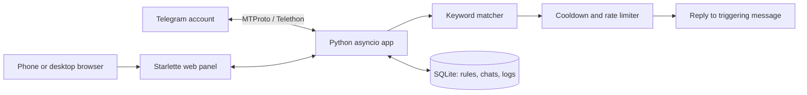

# Telegram Keyword Responder

Group-only Telegram keyword auto-responder with a mobile-friendly web panel.

[中文说明](README.zh-CN.md)

## What it does

The project signs in with a Telegram user account through Telethon (MTProto), watches **only the groups you explicitly allow**, matches keywords, and replies to the triggering message with a configured message.

It is designed for communities you own or administer: support groups, FAQ groups, interest groups, and small communities that want an automatic reply when a known question appears.

## Safety boundaries

- **No private-message sending.** The code has no path that sends a direct message to a group member.
- **No bulk messaging.** It only replies to the message that triggered a rule.
- **No member scraping.** It does not export or collect group members.
- **Group allowlist.** A group must be explicitly enabled in the web panel before anything is read.
- **Rate limits and cooldowns.** Per-group, per-keyword, per-user and global limits are built in.

> Telegram account automation is a userbot, not the official Bot API. Read [SECURITY.md](SECURITY.md) before using it with an important account.

## Features

- Web panel for account login, group selection, keyword rules, logs and limits
- Multiple groups and multiple keywords
- One reply per keyword, with independent text and cooldowns
- Matching modes: contains, regular expression, and word (word mode is for Latin words; CJK keywords automatically fall back to substring matching)
- Optional `{keyword}`, `{user}` and `{chat}` placeholders in reply text
- Per-group, per-keyword, per-user and global rate limits
- SQLite storage for rules, logs and settings
- Telegram login wizard with phone, code and two-step password support
- SOCKS5 / SOCKS4 / HTTP proxy support
- Mobile-friendly server-rendered UI
- Single process, standard-library-friendly design, easy to run behind systemd

## Architecture



## Requirements

- Python 3.11 or newer
- A Telegram account (a dedicated account is recommended)
- `api_id` and `api_hash` from <https://my.telegram.org>
- Optional: a working SOCKS5 / HTTP proxy if Telegram is not directly reachable

## Quick start (local)

```bash
git clone https://github.com/Xiaowu-0916/telegram-keyword-responder.git
cd telegram-keyword-responder

python -m venv .venv
source .venv/bin/activate
pip install -r requirements.txt

cp .env.example .env
# edit .env: set TGKR_INITIAL_PASSWORD and TGKR_SESSION_SECRET

python main.py
```

Open <http://127.0.0.1:8100> and sign in with the initial password from `.env`.

First-run flow:

1. Open the **Account** page and enter `api_id` / `api_hash`.
2. Enter the phone number and the Telegram login code.
3. Enter the two-step password if the account has one.
4. Open **Groups** and enable the groups you want to watch.
5. Open **Keywords** and create rules.
6. Send a matching message in a test group and check the **Logs** page.

## Docker

The repository includes a `Dockerfile` and `docker-compose.example.yml`.

```bash
cp .env.example .env
# set TGKR_BASE_DIR=/app, TGKR_DATA_DIR=/app/data, TGKR_DB_PATH=/app/data/state.db,
# TGKR_SESSION_PATH=/app/data/account and a strong password/secret
docker compose -f docker-compose.example.yml up -d --build
```

The example uses host networking so that the app can bind to `127.0.0.1` and be placed behind a local reverse proxy. See [docs/DEPLOYMENT.md](docs/DEPLOYMENT.md) for details.

## Configuration

The main configuration lives in `.env`:

| Variable | Default | Purpose |
| --- | --- | --- |
| `TGKR_BASE_DIR` | project root | Application directory |
| `TGKR_DATA_DIR` | `data` | Data directory |
| `TGKR_DB_PATH` | `data/state.db` | SQLite database |
| `TGKR_SESSION_PATH` | `data/account` | Telethon session file |
| `TGKR_ADMIN_USER` | `admin` | Web panel username |
| `TGKR_INITIAL_PASSWORD` | generated | Initial web panel password |
| `TGKR_SESSION_SECRET` | random per run | Session signing secret; set a fixed value in production |
| `TGKR_HTTPS_ONLY` | `0` | Set to `1` behind HTTPS |
| `TGKR_HOST` | `127.0.0.1` | Listen address |
| `TGKR_PORT` | `8100` | Listen port |

Proxy, rate limits, pause state and bot-message handling are configured in the web panel under **Settings**.

See [docs/CONFIGURATION.md](docs/CONFIGURATION.md) for the complete configuration reference.

## Keyword matching

| Mode | Behaviour | Example |
| --- | --- | --- |
| `contains` | Substring match | `price` matches "what is the price?" |
| `regex` | Python regular expression | `price|cost|how much` |
| `word` | Latin word-boundary match | `price` does not match `priceless` |

If a keyword contains CJK characters, Japanese kana or Hangul, `word` mode automatically falls back to substring matching. For example, `国庆` matches `欢度国庆`. This is intentional: Python treats CJK characters as word characters, so a strict word-boundary check would fail inside normal Chinese text.

Reply text can use `{keyword}`, `{user}` and `{chat}` placeholders.

## Deployment

For a Linux server:

1. Create a dedicated user and directory.
2. Install the Python virtual environment.
3. Create `.env`.
4. Install the systemd unit from `deploy/`.
5. Put the web panel behind a reverse proxy with HTTPS.
6. Configure a proxy for Telegram if the server cannot reach Telegram directly.

Full instructions: [docs/DEPLOYMENT.md](docs/DEPLOYMENT.md).

## Testing

```bash
pip install -r requirements.txt -r requirements-dev.txt
pytest -q
```

## Project layout

```text
app/
  matcher.py            keyword matching
  service.py            reply decisions and rate limits
  db.py                 SQLite storage
  telegram_manager.py   Telethon client, login wizard, listener
  web.py                Starlette web panel
  templates/            server-rendered UI
  static/               CSS
deploy/                 systemd and nginx templates
docs/                   architecture, deployment, configuration
tests/                  offline unit and web tests
main.py                 application entry point
```

## Security

- Use a dedicated Telegram account, not your primary account.
- Keep the reply frequency low.
- Only enable groups you own or administer.
- Do not use this project for unsolicited direct messages or bulk advertising.
- Protect `.env`, `data/state.db` and `data/account.session`.
- See [SECURITY.md](SECURITY.md) for the full security model and hardening checklist.

## License

MIT. See [LICENSE](LICENSE).
