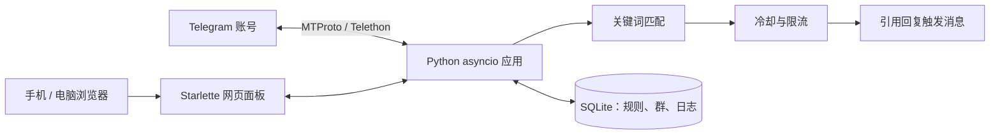

# Telegram 群关键词回复器

一个只在自己群内工作的 Telegram 关键词自动回复工具，带手机可用的网页管理面板。

[English](README.md)

## 它能做什么

程序使用 Telethon（MTProto）登录一个 Telegram 账号，只监听你明确启用的群，命中关键词后引用触发消息并回复预设内容。

适合自己拥有或管理的社区：客服群、FAQ 群、兴趣群、小型社群等。

## 安全边界

- **不私聊任何人**：代码里没有向群成员发送私聊的路径
- **不群发**：只回复触发规则的那条消息
- **不采集成员**：不会导出群成员
- **群白名单**：只有网页里启用的群才会被监听
- **冷却和限流**：群内、关键词、用户、全局四层限制

> 这是账号自动化（userbot），不是官方 Bot API。使用重要账号前请先阅读 [SECURITY.md](SECURITY.md)。

## 功能

- 网页管理：账号登录、群选择、关键词规则、日志、限流
- 多群、多关键词，每条关键词独立文案和冷却
- 匹配方式：包含、正则、整词（整词仅对英文单词生效；含中文时自动按包含处理）
- 回复支持 `{keyword}`、`{user}`、`{chat}` 占位符
- 群内、关键词、用户、全局四级限流
- SQLite 保存规则、日志和设置
- 网页完成 Telegram 手机号、验证码、两步验证登录
- 支持 SOCKS5 / SOCKS4 / HTTP 代理
- 移动端友好的服务端渲染界面
- 单进程 asyncio，适合 systemd 常驻

## 架构



## 环境要求

- Python 3.11 或更高版本
- 一个 Telegram 账号（建议使用专用小号）
- `my.telegram.org` 的 `api_id` 和 `api_hash`
- 如果服务器无法直连 Telegram，需要一个可用的 SOCKS5 / HTTP 代理

## 本地快速开始

```bash
git clone https://github.com/Xiaowu-0916/telegram-keyword-responder.git
cd telegram-keyword-responder

python -m venv .venv
source .venv/bin/activate
pip install -r requirements.txt

cp .env.example .env
# 编辑 .env：设置 TGKR_INITIAL_PASSWORD 和 TGKR_SESSION_SECRET

python main.py
```

打开 <http://127.0.0.1:8100>，用 `.env` 里的初始密码登录。

首次使用流程：

1. 进入“账号”页，填写 `api_id` / `api_hash`
2. 填写手机号，输入 Telegram 收到的验证码
3. 如果账号开启了两步验证，再输入两步验证密码
4. 进入“群管理”，勾选要监听的群
5. 进入“关键词”，新增规则
6. 在测试群发一条命中关键词的消息，查看“日志”页

## Docker

仓库包含 `Dockerfile` 和 `docker-compose.example.yml`：

```bash
cp .env.example .env
# 设置 TGKR_BASE_DIR=/app、TGKR_DATA_DIR=/app/data、
# TGKR_DB_PATH=/app/data/state.db、TGKR_SESSION_PATH=/app/data/account，
# 并设置强密码和固定 session secret
docker compose -f docker-compose.example.yml up -d --build
```

示例使用 host 网络，方便绑定 `127.0.0.1` 并放在本机反向代理后面。完整说明见 [docs/DEPLOYMENT.md](docs/DEPLOYMENT.md)。

## 配置

主要配置在 `.env`：

| 变量 | 默认值 | 用途 |
| --- | --- | --- |
| `TGKR_BASE_DIR` | 项目根目录 | 应用目录 |
| `TGKR_DATA_DIR` | `data` | 数据目录 |
| `TGKR_DB_PATH` | `data/state.db` | SQLite 数据库 |
| `TGKR_SESSION_PATH` | `data/account` | Telethon 会话文件 |
| `TGKR_ADMIN_USER` | `admin` | 网页登录用户名 |
| `TGKR_INITIAL_PASSWORD` | 自动生成 | 初始管理密码 |
| `TGKR_SESSION_SECRET` | 每次运行随机 | 会话签名密钥，生产环境必须固定 |
| `TGKR_HTTPS_ONLY` | `0` | HTTPS 后面设为 `1` |
| `TGKR_HOST` | `127.0.0.1` | 监听地址 |
| `TGKR_PORT` | `8100` | 监听端口 |

代理、限流、暂停、机器人消息过滤在网页“设置”页配置。

完整配置参考：[docs/CONFIGURATION.md](docs/CONFIGURATION.md)。

## 关键词匹配

| 模式 | 行为 | 例子 |
| --- | --- | --- |
| `contains` | 包含子串 | `价格` 匹配“请问价格是多少” |
| `regex` | Python 正则 | `价格|多少钱|怎么收费` |
| `word` | 英文单词边界 | `price` 不匹配 `priceless` |

关键词含中文、日文假名或韩文时，`word` 模式会自动按“包含”处理。例如 `国庆` 可以匹配 `欢度国庆`。这是刻意设计：Python 把中日韩字符视为单词字符，严格单词边界在中文句子里会失效。

回复内容支持 `{keyword}`、`{user}`、`{chat}` 占位符。

## 部署

Linux 服务器部署步骤：

1. 创建专用用户和目录
2. 创建 Python 虚拟环境
3. 创建 `.env`
4. 安装 `deploy/` 下的 systemd 单元
5. 用反向代理提供 HTTPS
6. 服务器无法直连 Telegram 时配置代理

完整说明：[docs/DEPLOYMENT.md](docs/DEPLOYMENT.md)。

## 测试

```bash
pip install -r requirements.txt -r requirements-dev.txt
pytest -q
```

## 项目结构

```text
app/
  matcher.py            关键词匹配
  service.py            回复决策和限流
  db.py                 SQLite 存储
  telegram_manager.py   Telethon 客户端、登录向导、监听
  web.py                Starlette 网页面板
  templates/            服务端渲染模板
  static/               CSS
deploy/                 systemd 和 nginx 模板
docs/                   架构、部署、配置
tests/                  离线单元和网页测试
main.py                 程序入口
```

## 安全

- 使用专用 Telegram 小号，不要用主账号
- 保持低频回复
- 只启用自己拥有或管理的群
- 不要用于主动私聊或群发广告
- 保护好 `.env`、`data/state.db`、`data/account.session`
- 完整安全说明见 [SECURITY.md](SECURITY.md)

## 许可证

MIT，见 [LICENSE](LICENSE)。
